# NexusEcole

SaaS **hybride** de gestion scolaire pour le Sénégal :
- un seul code, chaque école sur son sous-domaine avec ses couleurs (marque blanche) ;
- une console super-admin pour gérer les écoles, les forfaits et les factures ;
- la possibilité de passer une école sur une **instance dédiée** sans changer de code.

## Aperçu

Design inspiré d'AP2A Impact (Plus Jakarta Sans / Outfit, barre latérale, bandeaux en dégradé, mode sombre),
aux couleurs de chaque école.

| Accueil de l'école | Fiche élève : échéances et paiements |
|---|---|
| 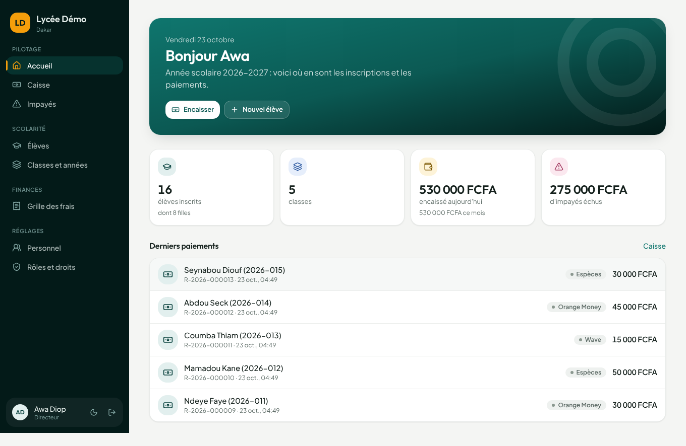 | 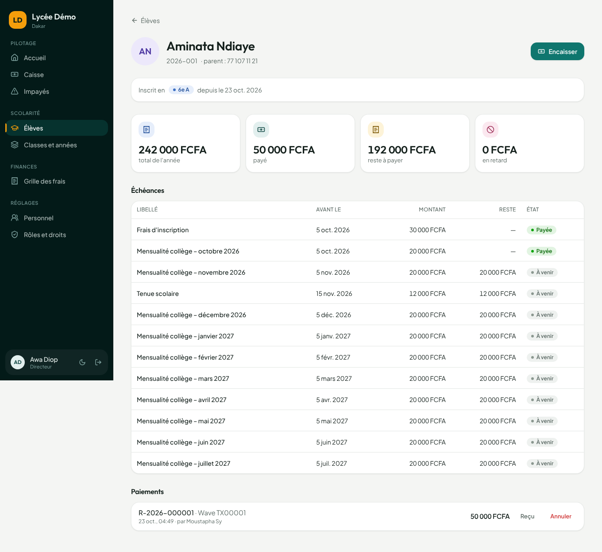 |

| Encaissement (Wave, OM, espèces…) | Reçu imprimable |
|---|---|
| 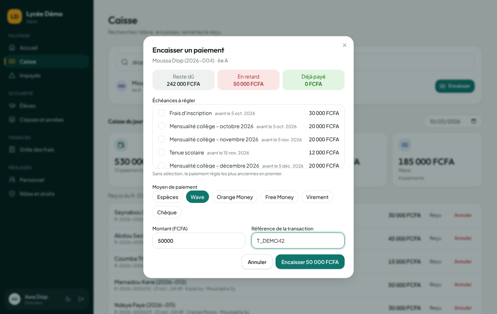 | 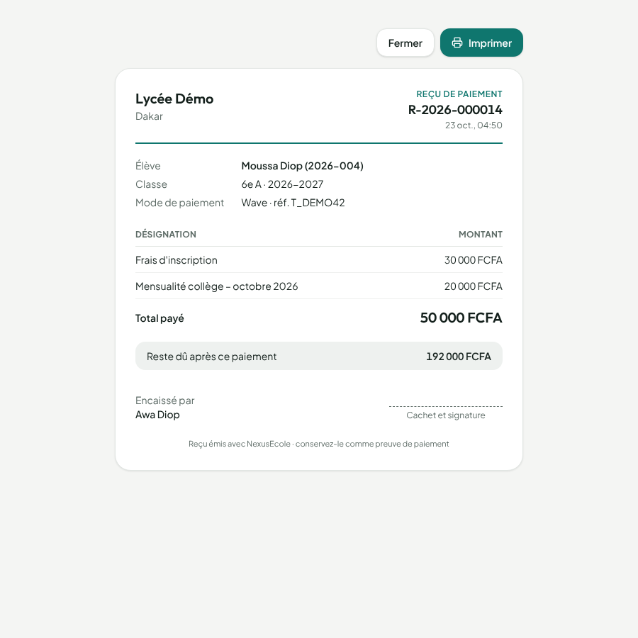 |

| Impayés avec relance WhatsApp | Rôles et droits configurables |
|---|---|
| 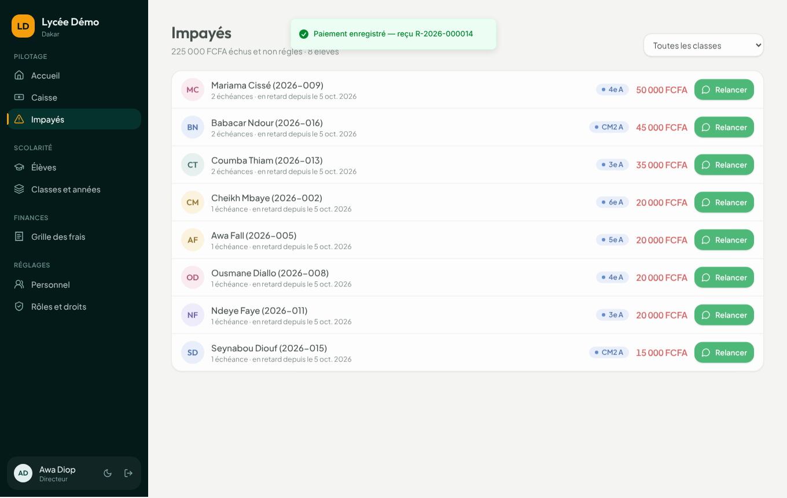 | 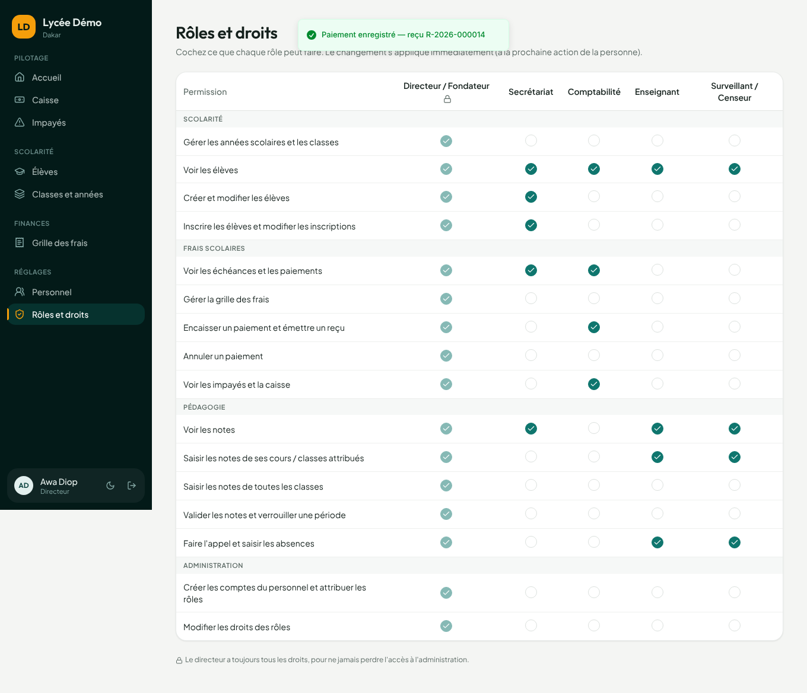 |

| Saisie des notes (professeur) | Résultats, rangs, conseil de classe |
|---|---|
| 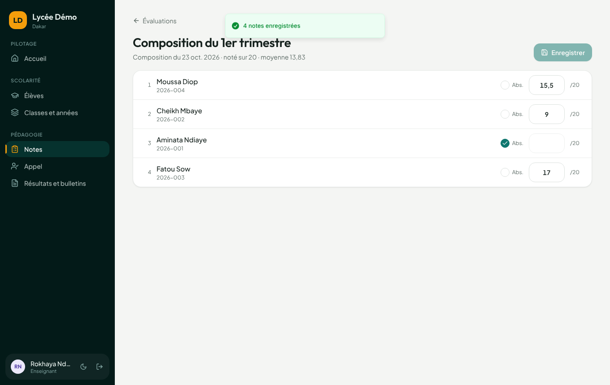 | 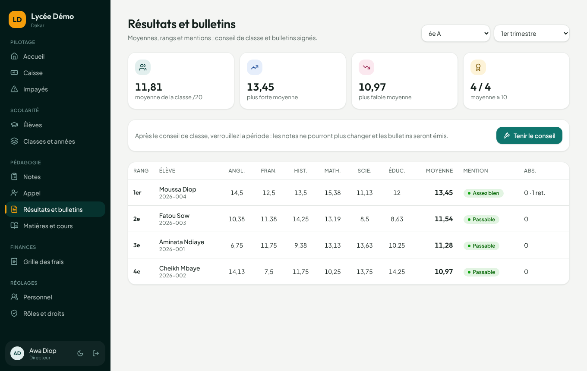 |

| Bulletin signé avec QR code | Vérification publique du QR | Appel sur téléphone |
|---|---|---|
| 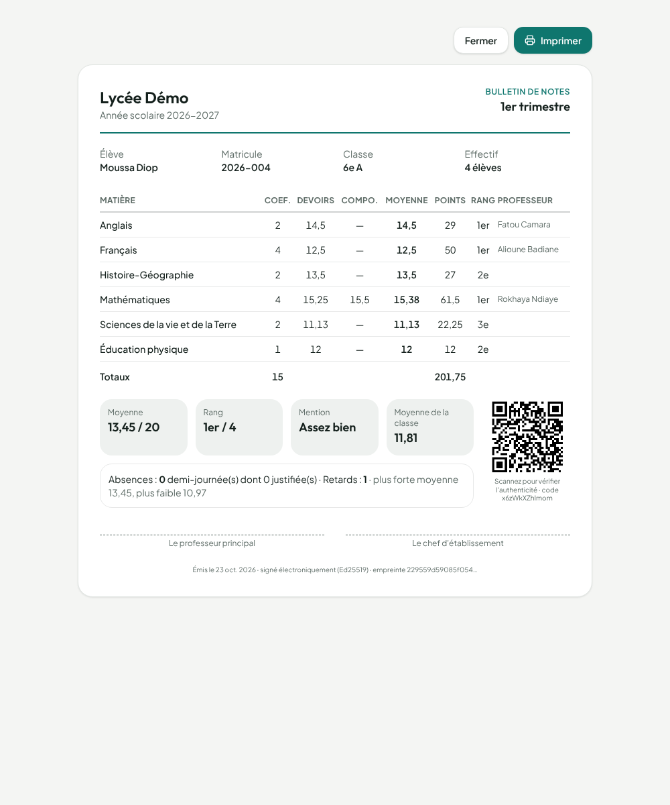 | 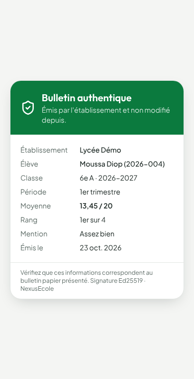 | 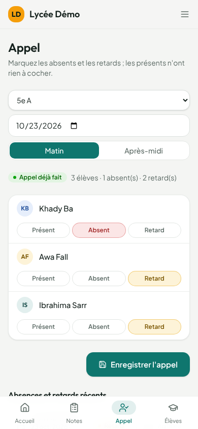 |

| Autre école, autres couleurs | Mode sombre | Téléphone |
|---|---|---|
| 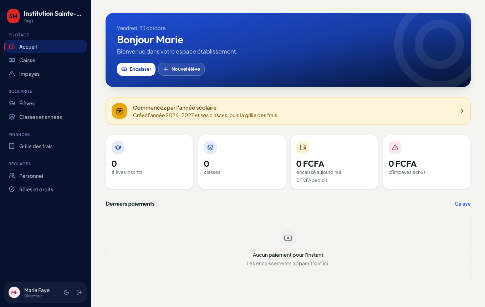 | 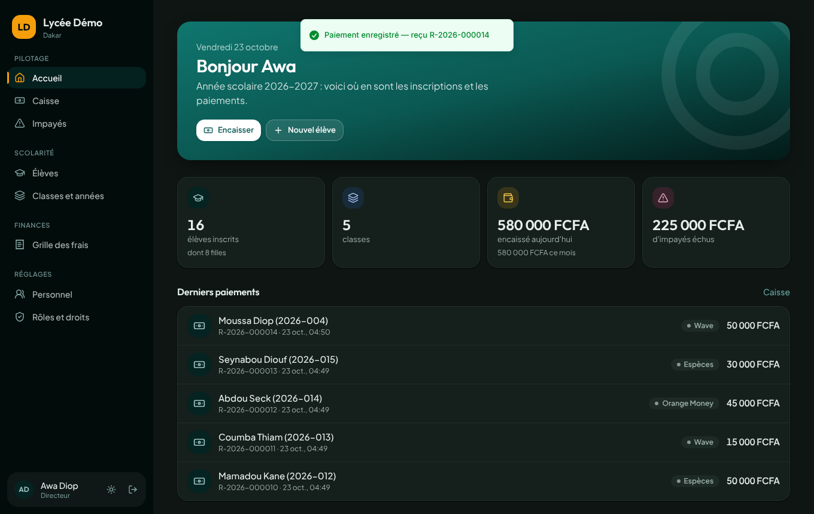 | 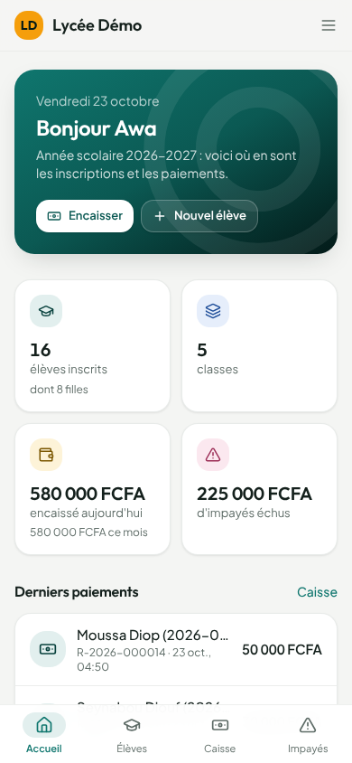 |

## Architecture

```
admin.nexusecole.sn  ──► console super-admin  ─┐
lycee-x.nexusecole.sn ─► espace école (React) ─┼─► API Django (un seul code)
ecole-y.nexusecole.sn ─┘                        │   TenantMainMiddleware : hôte → schéma
                                                 ▼
                         PostgreSQL : public | lycee_x | ecole_y | …
```

| Schéma | Contenu |
|---|---|
| `public` | `Ecole`, `Domaine`, `Forfait`, `Abonnement`, `Facture`, super-admins |
| un par école | utilisateurs de l'école, années, classes, élèves (puis notes, frais, absences…) |

- **Backend** : Django 5.1, django-tenants (un schéma PostgreSQL par école), DRF, SimpleJWT
- **Frontend** : React 19, Vite, TypeScript, Tailwind CSS 4, Radix UI, TanStack Query ; un seul build, le sous-domaine `admin.` affiche la console

### Sécurité multi-tenant

| Garantie | Mécanisme | Test |
|---|---|---|
| Une école ne lit jamais les données d'une autre | un schéma PostgreSQL par école | `test_chaque_ecole_ne_voit_que_ses_eleves` |
| Un jeton de l'école A est inutilisable sur l'école B, même si les `user_id` coïncident | claim `schema` vérifiée à chaque requête et à chaque rafraîchissement | `test_jeton_ecole_a_refuse_sur_ecole_b`, `test_refresh_ecole_a_refuse_sur_ecole_b` |
| Un compte école n'accède pas à la console, et inversement | utilisateurs propres à chaque schéma, permission `EstSuperAdmin` | `test_jeton_ecole_refuse_sur_console_admin`, `test_super_admin_refuse_sur_une_ecole` |
| Impayé : lecture seule (les données restent consultables). Résiliation : blocage | permission `AbonnementValide` | `test_ecole_suspendue_en_lecture_seule`, `test_ecole_resiliee_bloquee` |
| Respect des limites du forfait (élèves, modules) | `EleveSerializer.validate`, `ModuleActif` | `test_quota_eleves_du_forfait` |
| Un enseignant ne note que ses cours ; un surveillant, ses classes | `peut_saisir_notes`, `peut_faire_l_appel` | `test_seul_le_prof_du_cours_ou_le_surveillant_affecte_saisit` |
| Aucune note ne change après le conseil de classe | verrouillage par classe et période | `test_conseil_verrouille_et_emet_des_bulletins_signes` |
| Toute modification de note est tracée et infalsifiable | journal chaîné (SHA-256 de la ligne précédente) | `test_journal_chaine_et_falsification_detectee` |
| Un bulletin falsifié est détecté | signature Ed25519 (clé par école, dérivée par HKDF) + QR code | `test_bulletin_falsifie_detecte` |
| Protection contre la force brute à la connexion | limite de 10 tentatives par minute | non testé |

## Démarrage avec Docker (recommandé, Windows / Mac / Linux)

Prérequis : [Docker Desktop](https://www.docker.com/products/docker-desktop/) et Git.

```bash
git clone https://github.com/AlsenyTECH/nexusecole.git
cd nexusecole
docker compose up --build
```

Au premier lancement : base de données, plateforme, super-admin et école de démo sont créés automatiquement.

| Adresse | Identifiants |
|---|---|
| http://admin.localhost:5173 (console) | `admin@nexusecole.sn` / `Admin-Nexus-2026` |
| http://lycee-demo.localhost:5173 (école, directeur) | `directeur@lycee-demo.sn` / `Demo-Nexus-2026` |
| http://lycee-demo.localhost:5173 (école, caissier) | `caisse@lycee-demo.sn` / `Demo-Nexus-2026` |
| http://lycee-demo.localhost:5173 (professeur de maths) | `prof@lycee-demo.sn` / `Demo-Nexus-2026` |
| http://lycee-demo.localhost:5173 (surveillant 6e A, 5e A) | `surveillant@lycee-demo.sn` / `Demo-Nexus-2026` |

L'école de démo est remplie automatiquement : année scolaire, 5 classes, grille des frais,
16 élèves inscrits, quelques paiements, les matières et enseignants, 3 trimestres,
des notes en 6e A et quelques absences.

Le code est monté dans les conteneurs : modifiez un fichier dans VS Code, l'application se recharge.

- Lancer les tests : `docker compose exec backend python manage.py test`
- Arrêter : `Ctrl + C` puis `docker compose down` (ajouter `-v` pour effacer la base)

## Démarrage en local sans Docker

Prérequis : Python 3.12+, Node 20+, PostgreSQL 16.

```bash
# Backend
cd backend
python -m venv .venv && source .venv/bin/activate
pip install -r requirements.txt
python manage.py migrate_schemas --shared
python manage.py init_plateforme --email admin@nexusecole.sn
python manage.py creer_ecole_demo lycee-demo
python manage.py runserver 8000

# Frontend (dans un autre terminal)
cd frontend
npm install
npm run dev
```

Les sous-domaines `*.localhost` pointent automatiquement vers votre machine :

- Console : http://admin.localhost:5173 (avec le super-admin créé par `init_plateforme`)
- École de démo : http://lycee-demo.localhost:5173, identifiants `directeur@lycee-demo.sn` / `Demo-Nexus-2026`

Lancer les tests : `cd backend && python manage.py test`

## API

**Console** (`admin.<domaine>`)

| Méthode | Route | Rôle |
|---|---|---|
| POST | `/api/auth/connexion`, `/api/auth/rafraichir` | obtenir et renouveler les jetons JWT |
| GET | `/api/admin/statistiques` | écoles par statut, revenu mensuel récurrent, impayés |
| GET/POST/PATCH | `/api/admin/ecoles` | lister, créer (schéma + domaine + directeur), modifier une école |
| POST | `/api/admin/ecoles/{id}/suspendre` · `activer` · `resilier` · `facturer` | gérer le cycle de vie commercial |
| GET/POST | `/api/admin/forfaits` | gérer les forfaits |
| GET, POST | `/api/admin/factures`, `/api/admin/factures/{id}/payer` | consulter les factures, enregistrer un paiement (Wave, OM…) |

**École** (`<ecole>.<domaine>`)

| Méthode | Route | Rôle |
|---|---|---|
| GET | `/api/ecole/config` | configuration de la marque blanche (publique, lue avant connexion) |
| POST | `/api/auth/connexion`, `/api/auth/rafraichir` | jetons JWT liés à l'école |
| GET | `/api/moi` | utilisateur connecté |
| CRUD | `/api/annees`, `/api/classes`, `/api/eleves` | scolarité |
| GET, POST, PATCH | `/api/inscriptions` | inscriptions (génèrent les échéances) |
| GET | `/api/inscriptions/{id}/situation` | échéances, payé, reste, retard d'un élève |
| CRUD | `/api/frais` | grille des frais de l'année |
| GET, POST | `/api/paiements` | encaisser (imputation automatique, reçu numéroté) |
| POST, GET | `/api/paiements/{id}/annuler`, `/api/paiements/{id}/recu` | annulation avec motif, données du reçu |
| GET | `/api/finances/impayes`, `/api/finances/caisse?date=` | impayés, caisse du jour |
| GET, PATCH | `/api/roles`, `/api/roles/{code}` | droits de chaque rôle (modifiables par le directeur) |
| GET, POST, PATCH | `/api/personnel` | comptes du personnel |

| GET, PATCH | `/api/pedagogie/parametres` | découpage, poids devoirs / composition, validation des notes du surveillant |
| CRUD, POST | `/api/periodes`, `/api/periodes/generer` | trimestres ou semestres |
| CRUD | `/api/matieres`, `/api/cours`, `/api/surveillances` | matières, cours (coef. + enseignant), surveillants par classe |
| GET | `/api/cours/mes-cours` | cours où l'utilisateur peut saisir |
| CRUD | `/api/evaluations` | devoirs et compositions |
| GET, POST | `/api/evaluations/{id}/notes`, `/api/evaluations/{id}/valider` | grille de saisie, validation par l'enseignant |
| GET, POST | `/api/appel` | appel d'une classe (matin / après-midi) |
| GET, PATCH | `/api/absences` | absences, justification |
| GET | `/api/resultats?classe=&periode=` | moyennes, rangs, mentions, statistiques |
| POST | `/api/conseils` | conseil de classe : verrouillage + bulletins signés |
| GET | `/api/bulletins`, `/api/pedagogie/journal` | bulletins émis, intégrité du journal des notes |
| GET | `/api/verifier/{code}` | **public** : authenticité d'un bulletin (QR code) |

Chaque route vérifie une **permission** (ex. `frais.encaisser`) ; le directeur règle les permissions
de chaque rôle. Voir le [cahier des charges](docs/cahier-des-charges.md).

## Forfaits par défaut

| Forfait | Prix | Élèves | Modules |
|---|---|---|---|
| Starter | 25 000 FCFA/mois | 200 | scolarité, frais, notes, absences |
| Standard | 50 000 FCFA/mois | 600 | + espace parents, SMS |
| Premium | 100 000 FCFA/mois | illimité | + paiement mobile |

Paiement annuel (10 mois) : 2 mois offerts.

## Feuille de route

- [x] **Phase 0 – Socle** : multi-tenant, marque blanche, console, forfaits, factures, tests d'isolation
- [x] **Phase 1a** : droits configurables, inscriptions, frais, échéances, paiements, reçus, impayés, caisse (API)
- [x] **Phase 1b** : matières, cours, attributions, notes, moyennes et rangs, conseil de classe, bulletins signés (QR code), appel et absences
- [x] **Phase 1c** : nouveau design inspiré d'AP2A Impact (écrans école et console)
- [ ] **Phase 2 – Parents** : PWA parents, SMS/WhatsApp, paiement Wave / Orange Money
- [ ] **Phase 3 – Pilotes** : 3 à 5 écoles
- [ ] **Phase 4 – Commercial** : facturation automatique, relances, instance dédiée, modules payants

## Mise en production

Tout est prêt pour un serveur (VPS) : **[guide pas à pas](docs/deploiement.md)**.

```bash
cp deploy/env.production.example .env   # domaine + secrets
docker compose -f docker-compose.prod.yml up -d --build
docker compose -f docker-compose.prod.yml exec backend python manage.py init_plateforme --email vous@domaine
```

- **Caddy** en façade : HTTPS automatique pour chaque école (certificat à la demande, uniquement pour
  les domaines déclarés dans la console), interface React servie en fichiers statiques
- **gunicorn** pour l'API ; migrations de toutes les écoles au démarrage
- **Sauvegarde quotidienne** de toute la base, conservée 14 jours, restauration testée
- DNS : `A @` et `A *` vers l'IP du serveur
