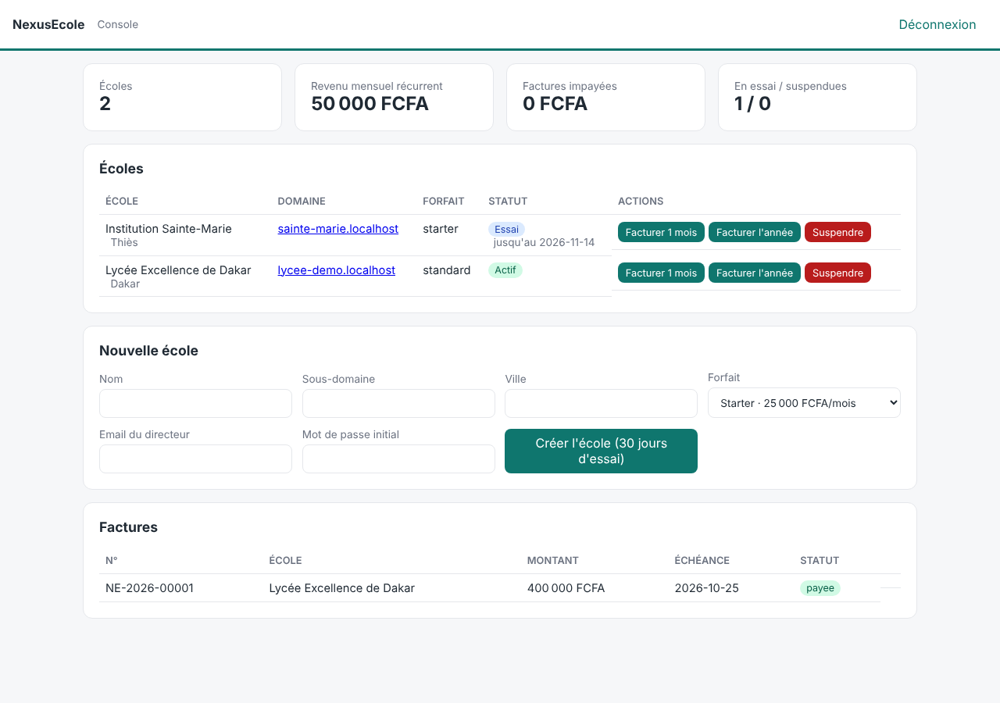
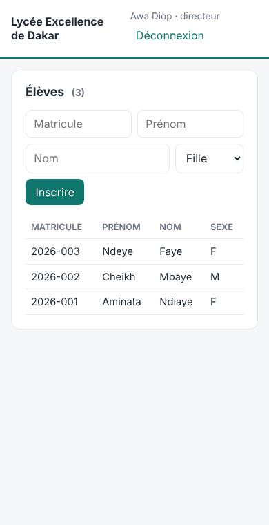
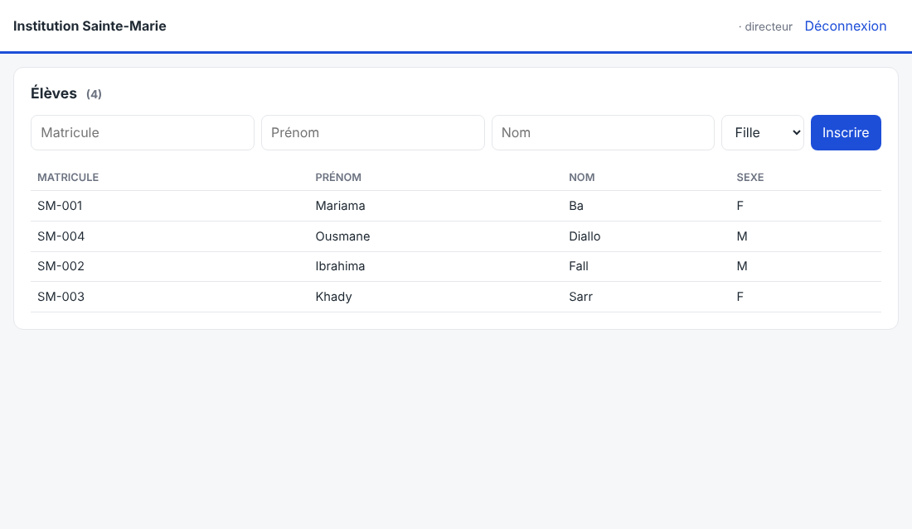
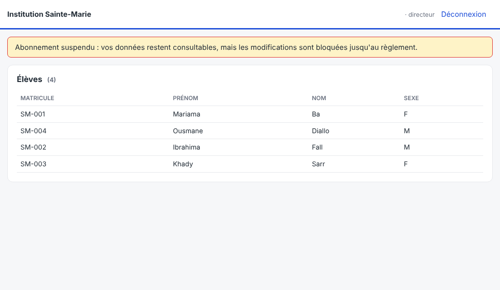

# NexusEcole

SaaS **hybride** de gestion scolaire pour le Sénégal :
- un seul code, chaque école sur son sous-domaine avec ses couleurs (marque blanche) ;
- une console super-admin pour gérer les écoles, les forfaits et les factures ;
- la possibilité de passer une école sur une **instance dédiée** sans changer de code.

## Aperçu

| Console super-admin | Espace école (mobile) |
|---|---|
|  |  |

| Même code, autre école (marque blanche) | École suspendue : lecture seule |
|---|---|
|  |  |

## Architecture

```
admin.nexusecole.sn  ──► console super-admin  ─┐
lycee-x.nexusecole.sn ─► espace école (React) ─┼─► API Django (un seul code)
ecole-y.nexusecole.sn ─┘                        │   TenantMainMiddleware : hôte → schéma
                                                 ▼
                         PostgreSQL : public | lycee_x | ecole_y | …
```

| Schéma | Contenu |
|---|---|
| `public` | `Ecole`, `Domaine`, `Forfait`, `Abonnement`, `Facture`, super-admins |
| un par école | utilisateurs de l'école, années, classes, élèves (puis notes, frais, absences…) |

- **Backend** : Django 5.1, django-tenants (un schéma PostgreSQL par école), DRF, SimpleJWT
- **Frontend** : React 18 + Vite + TypeScript, un seul build ; le sous-domaine `admin.` affiche la console

### Sécurité multi-tenant

| Garantie | Mécanisme | Test |
|---|---|---|
| Une école ne lit jamais les données d'une autre | un schéma PostgreSQL par école | `test_chaque_ecole_ne_voit_que_ses_eleves` |
| Un jeton de l'école A est inutilisable sur l'école B, même si les `user_id` coïncident | claim `schema` vérifiée à chaque requête et à chaque rafraîchissement | `test_jeton_ecole_a_refuse_sur_ecole_b`, `test_refresh_ecole_a_refuse_sur_ecole_b` |
| Un compte école n'accède pas à la console, et inversement | utilisateurs propres à chaque schéma, permission `EstSuperAdmin` | `test_jeton_ecole_refuse_sur_console_admin`, `test_super_admin_refuse_sur_une_ecole` |
| Impayé : lecture seule (les données restent consultables). Résiliation : blocage | permission `AbonnementValide` | `test_ecole_suspendue_en_lecture_seule`, `test_ecole_resiliee_bloquee` |
| Respect des limites du forfait (élèves, modules) | `EleveSerializer.validate`, `ModuleActif` | `test_quota_eleves_du_forfait` |
| Protection contre la force brute à la connexion | limite de 10 tentatives par minute | non testé |

## Démarrage avec Docker (recommandé, Windows / Mac / Linux)

Prérequis : [Docker Desktop](https://www.docker.com/products/docker-desktop/) et Git.

```bash
git clone https://github.com/AlsenyTECH/nexusecole.git
cd nexusecole
docker compose up --build
```

Au premier lancement : base de données, plateforme, super-admin et école de démo sont créés automatiquement.

| Adresse | Identifiants |
|---|---|
| http://admin.localhost:5173 (console) | `admin@nexusecole.sn` / `Admin-Nexus-2026` |
| http://lycee-demo.localhost:5173 (école) | `directeur@lycee-demo.sn` / `Demo-Nexus-2026` |

Le code est monté dans les conteneurs : modifiez un fichier dans VS Code, l'application se recharge.

- Lancer les tests : `docker compose exec backend python manage.py test`
- Arrêter : `Ctrl + C` puis `docker compose down` (ajouter `-v` pour effacer la base)

## Démarrage en local sans Docker

Prérequis : Python 3.12+, Node 20+, PostgreSQL 16.

```bash
# Backend
cd backend
python -m venv .venv && source .venv/bin/activate
pip install -r requirements.txt
python manage.py migrate_schemas --shared
python manage.py init_plateforme --email admin@nexusecole.sn
python manage.py creer_ecole_demo lycee-demo
python manage.py runserver 8000

# Frontend (dans un autre terminal)
cd frontend
npm install
npm run dev
```

Les sous-domaines `*.localhost` pointent automatiquement vers votre machine :

- Console : http://admin.localhost:5173 (avec le super-admin créé par `init_plateforme`)
- École de démo : http://lycee-demo.localhost:5173, identifiants `directeur@lycee-demo.sn` / `Demo-Nexus-2026`

Lancer les tests : `cd backend && python manage.py test`

## API

**Console** (`admin.<domaine>`)

| Méthode | Route | Rôle |
|---|---|---|
| POST | `/api/auth/connexion`, `/api/auth/rafraichir` | obtenir et renouveler les jetons JWT |
| GET | `/api/admin/statistiques` | écoles par statut, revenu mensuel récurrent, impayés |
| GET/POST/PATCH | `/api/admin/ecoles` | lister, créer (schéma + domaine + directeur), modifier une école |
| POST | `/api/admin/ecoles/{id}/suspendre` · `activer` · `resilier` · `facturer` | gérer le cycle de vie commercial |
| GET/POST | `/api/admin/forfaits` | gérer les forfaits |
| GET, POST | `/api/admin/factures`, `/api/admin/factures/{id}/payer` | consulter les factures, enregistrer un paiement (Wave, OM…) |

**École** (`<ecole>.<domaine>`)

| Méthode | Route | Rôle |
|---|---|---|
| GET | `/api/ecole/config` | configuration de la marque blanche (publique, lue avant connexion) |
| POST | `/api/auth/connexion`, `/api/auth/rafraichir` | jetons JWT liés à l'école |
| GET | `/api/moi` | utilisateur connecté |
| CRUD | `/api/annees`, `/api/classes`, `/api/eleves` | scolarité (écriture réservée à la direction et au secrétariat) |

## Forfaits par défaut

| Forfait | Prix | Élèves | Modules |
|---|---|---|---|
| Starter | 25 000 FCFA/mois | 200 | scolarité, frais, notes, absences |
| Standard | 50 000 FCFA/mois | 600 | + espace parents, SMS |
| Premium | 100 000 FCFA/mois | illimité | + paiement mobile |

Paiement annuel (10 mois) : 2 mois offerts.

## Feuille de route

- [x] **Phase 0 – Socle** : multi-tenant, marque blanche, console, forfaits, factures, tests d'isolation
- [ ] **Phase 1 – MVP école** : frais scolaires et reçus, notes, bulletins PDF signés (QR code), absences
- [ ] **Phase 2 – Parents** : PWA parents, SMS/WhatsApp, paiement Wave / Orange Money
- [ ] **Phase 3 – Pilotes** : 3 à 5 écoles
- [ ] **Phase 4 – Commercial** : facturation automatique, relances, instance dédiée, modules payants

## Production (exemple)

- DNS : `*.nexusecole.sn` et `admin.nexusecole.sn` pointent vers le serveur, avec un certificat TLS wildcard.
- Variables : `DEBUG=false`, `SECRET_KEY`, `DATABASE_URL`, `BASE_DOMAIN=nexusecole.sn`, `PUBLIC_DOMAIN=admin.nexusecole.sn`, `ALLOWED_HOSTS=.nexusecole.sn`.
- À chaque déploiement : `python manage.py migrate_schemas`, qui migre le schéma public **et** toutes les écoles.
- **Instance dédiée** : même image, autre base. Pour y transférer une école : `pg_dump -n <schema>`.
- Données personnelles : déclarer le traitement auprès de la CDP (loi n° 2008-12).
